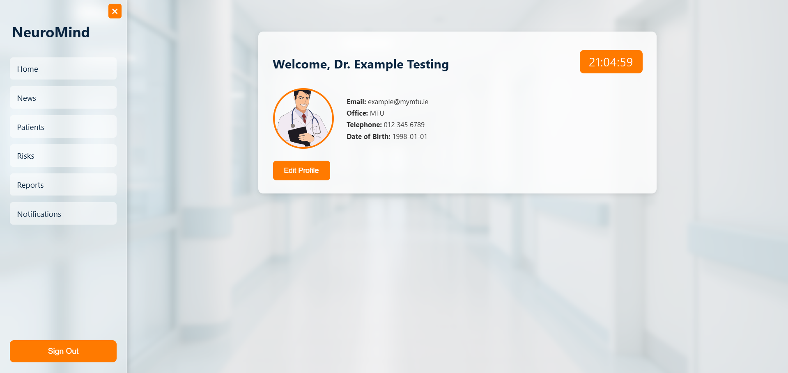
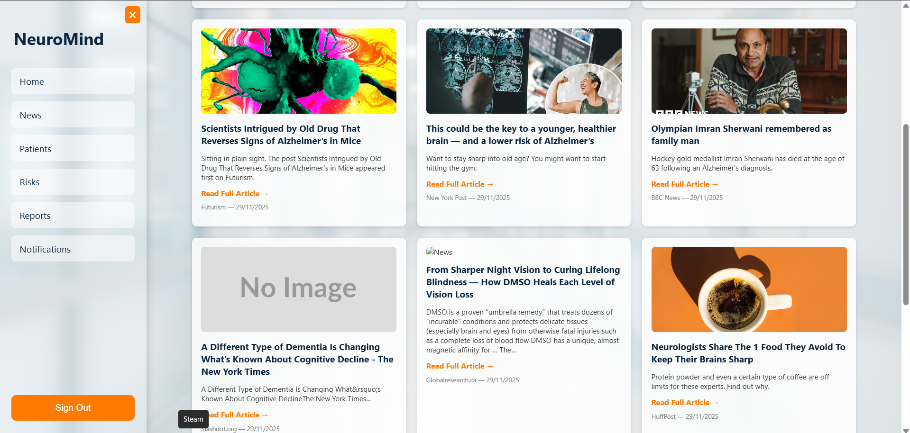
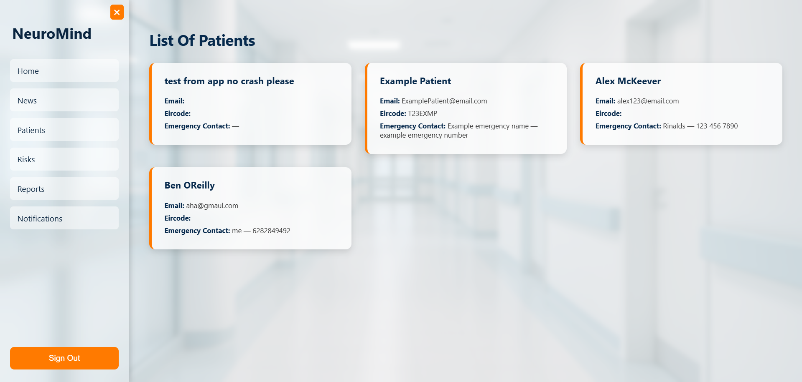
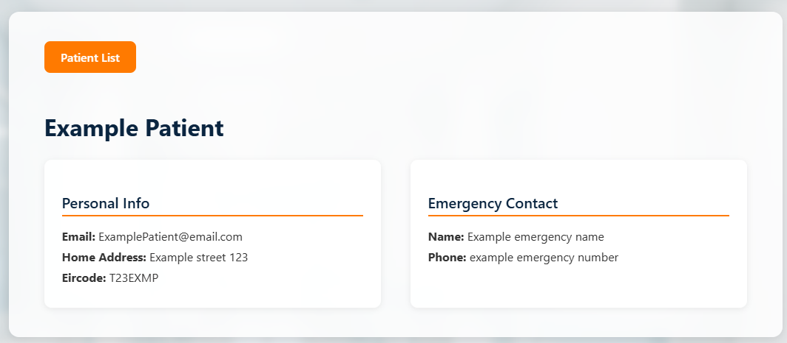

# Alzheimer's Detection System

A university group project developed as part of the Software Development degree at Munster Technological University (MTU). The system combines an Android patient application, a web-based doctor portal and a Python AI backend to provide a platform for Alzheimer's screening using speech, cognitive, and lifestyle assessments.

## Project Overview

The Alzheimer's Detection System was developed to explore how speech analysis, cognitive testing and lifestyle factors could support the screening of Alzheimer's disease.

The Android application incorporates three main assessment features:

- **Cognitive Assessment:** Covers orientation, memory, attention and recall.
- **Lifestyle Questionnaire:** Collects information about lifestyle factors through a series of questions.
- **Speech Assessment:** Records patient speech for analysis by the AI backend.

The results from these assessments are combined using assigned weighted values to produce an overall screening result.

## Components
The project consists of three main components:

- **Android Application:** A Kotlin-based mobile application for patients to register, manage their profiles and complete assessments.
- **Web Portal:** A React-based portal for doctors and administrators to access patient information, review assessments and manage data.
- **AI Backend:** A Python backend responsible for processing speech recordings and generating an audio prediction using a trained machine learning model.

Firebase is used to support authentication, data storage and communication between the applications.

## Screenshots

### Doctor Web Portal

### Android Patient Application

 

## Technologies Used

- Android Application: Kotlin, Android Studio
- Web Portal: React, JavaScript, Vite, CSS
- Backend: Python, Flask
- Database and Authentication: Firebase Authentication, Cloud Firestore, Firebase Storage
- AI / Machine Learning: Python, TensorFlow, Keras
- Cloud Services: Google Cloud

## My Contributions

This was a collaborative project completed by a group of four students. I contributed to the development of both the Android application and React web portal, with my main responsibilities focusing on Firebase integration and connecting the applications.

My contributions included:

- Implementing Firebase Authentication, including email/password and Google sign-in.
- Integrating Cloud Firestore to store and retrieve user profiles, assessment information and application data.
- Implementing Firebase Storage functionality for speech recordings and profile images.
- Connecting patient information between the Android application and the React web portal.
- Developing and modifying features across the Android and web applications.
- Contributing to application UI design, wireframes, planning and feature discussions.
- Testing the Android and web applications and assisting with identifying and resolving issues.
- Researching payment integration options and Firebase storage limitations.

The AI model development and training were handled by another member of the project team.

## Project Status

This repository contains a copy of the original university group project, published for portfolio and educational purposes.

Some original configuration files and credentials have been excluded. Running the applications may require setting up your own Firebase and Google Cloud configuration.

## Disclaimer

This project was developed for educational purposes as part of a university group project. Its screening approach was informed by extensive research into Alzheimer's disease assessment methods, including practical insights gathered from a healthcare professional experienced in conducting these types of assessments.

The assessment system combines multiple tests with assigned weighted values to produce an overall screening result. While considerable research and consideration went into its design, the system has not undergone formal clinical validation and is not intended to replace professional medical assessment or provide a medical diagnosis.